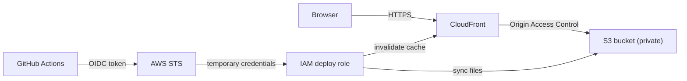

# TaskFlow Infra


Infrastructure as code that hosts the [TaskFlow Dashboard](https://github.com/sciamanamarcio/taskflow-dashboard) on **AWS**, written with **Terraform**. It creates a private S3 bucket served through CloudFront, a remote state backend, a cost alert, and an IAM role that lets GitHub Actions deploy without any stored AWS keys.

> **Status:** the code is validated on every pull request (`terraform fmt`, `terraform validate` and a checkov security scan). Deploying it to an AWS account is optional and described below.

## What it creates

| Piece | Resources | Purpose |
|-------|-----------|---------|
| `bootstrap` | S3 bucket for the state (versioned, encrypted, private), AWS Budget | Remote state and a monthly cost alert by email |
| `modules/static-site` | Private S3 bucket, CloudFront distribution with Origin Access Control, bucket policy | Serves a single-page app over HTTPS |
| `modules/github-oidc` | OIDC provider, IAM role with a least-privilege policy | Lets one repository deploy, with temporary credentials |
| `envs/dev` | Composition of the modules, S3 backend | The development environment |

## Architecture



```
.
├── bootstrap/            # state bucket and budget alert (applied once, local state)
├── modules/
│   ├── static-site/      # S3 + CloudFront
│   └── github-oidc/      # OIDC provider and deploy role
├── envs/
│   └── dev/              # environment that uses the modules
├── .checkov.yaml         # security scan configuration, with the reason for each skipped check
└── .github/workflows/    # CI
```

## Prerequisites

- Terraform 1.10 or later
- To deploy: an AWS account and the AWS CLI configured with credentials that can create the resources above

Everything up to `terraform validate` works without an AWS account.

## Usage

### 1. State bucket and cost alert (once)

```bash
cd bootstrap
cp terraform.tfvars.example terraform.tfvars   # set alert_email
terraform init
terraform apply
```

This stack keeps its own state locally, because it creates the bucket that holds the state of the others.

### 2. Site and deploy role

```bash
cd ../envs/dev
terraform init \
  -backend-config="bucket=$(terraform -chdir=../../bootstrap output -raw state_bucket_name)" \
  -backend-config="region=us-east-1"
terraform apply
terraform output
```

The outputs give the site URL, the bucket name, the CloudFront distribution ID and the role ARN. The role ARN is the `role-to-assume` of a GitHub Actions workflow that deploys the dashboard.

### Validate without an AWS account

```bash
terraform fmt -check -recursive
cd envs/dev && terraform init -backend=false && terraform validate
```

### Tear down

```bash
cd envs/dev && terraform destroy
```

The state bucket is versioned, so it must be emptied (including old versions) before `bootstrap` can be destroyed.

## Cost

A small static site on S3 and CloudFront costs a few cents per month. The `bootstrap` stack creates a budget that emails an alert at 80% of the limit (actual) and 100% (forecast), US$ 5 by default.

## CI

On every pull request, GitHub Actions runs:

- `terraform fmt -check` on the whole repository
- `terraform init -backend=false` and `terraform validate` for each stack
- a [checkov](https://www.checkov.io/) security scan. The few checks that are skipped are listed in `.checkov.yaml`, each with the reason.

Dependabot keeps the Terraform providers, the Python tooling and the GitHub Actions up to date.

## Design decisions

- **S3 native state locking** (`use_lockfile`) instead of a DynamoDB table: one less resource to run and pay for.
- **Origin Access Control** instead of the legacy Origin Access Identity, and a bucket that is never public.
- **GitHub OIDC instead of access keys**: nothing secret is stored in GitHub, and credentials expire after an hour.
- **Role trust limited to one repository and one branch**, matched exactly, and a policy that only allows syncing one bucket and invalidating one distribution.
- **Managed CloudFront policies** for caching and security headers, so the defaults follow AWS best practices.
- **SPA-friendly error handling**: 403 and 404 answers return `index.html`, so client-side routes work on reload.
- **Skipped scan checks are documented**: each one is a decision about cost or scope, not a silenced warning.
- **`force_destroy` only in the dev environment**, so tearing it down is easy and production-like stacks stay protected.

## Roadmap

- [ ] Custom domain with Route 53 and ACM
- [ ] CloudFront and S3 access logs
- [ ] `terraform plan` as a pull request comment, using the OIDC role
- [ ] A `prod` environment
- [ ] TFLint in CI
- [ ] Infrastructure for the API (container service and managed database)

## License

MIT
